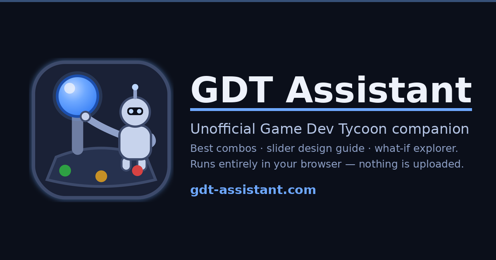
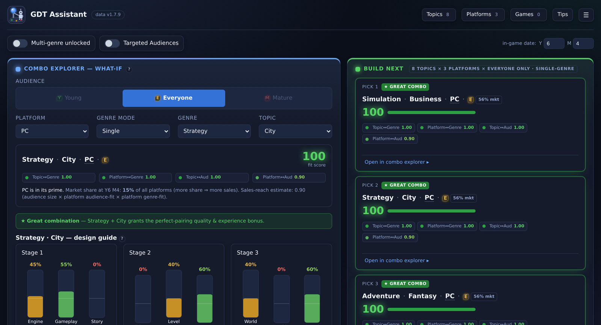
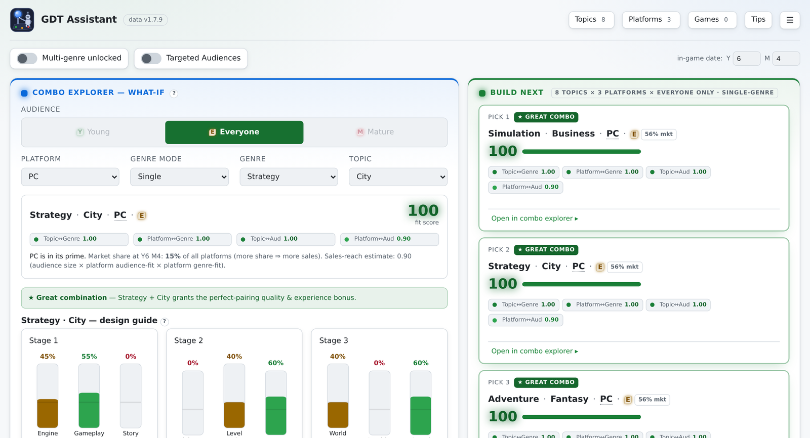

 

&nbsp;
&nbsp;
&nbsp;

# GDT Assistant

A free, single-file web tool (works fully offline too) that helps you plan the best games in
**[Game Dev Tycoon](https://www.greenheartgames.com/app/game-dev-tycoon/)**. It recommends the
best **Audience + Platform + Genre(s) + Topic** packages to build next, shows the optimal
**3-stage / 9-slider** design guide for any genre, and lets you explore any combination in a
what-if breakdown — all in your browser, with **no server, no accounts, and no cookies**.

> **Unofficial fan tool. Not affiliated with, endorsed by, or sponsored by Greenheart Games.**
> *Game Dev Tycoon* and all related names and trademarks are the property of Greenheart Games.
> Please support the developers by buying the game (links below).

## Features
- **Top-3 recommendations** across the topics/platforms/audiences you've unlocked, ranked by combo
  fit (topic↔genre dominant), tie-broken by an estimated sales reach. Great combos are badged; clearly
  bad combos are never recommended.
- **Research next** — tag the locked topics the game is currently offering with the *offered* pill
  (Topics list); the tool ranks which to research first by the best package each would unlock, with
  the projected gain over your current best pick.
- **Combo explorer** — pick any Audience + Platform + Genre(s) + Topic for a full fit breakdown.
- **Slider / development guide** — vertical sliders per stage (like the in-game screen) with the
  target fill for each of the 9 design areas, plus the genre's Design/Technology balance. Where several
  splits tie for the max review bonus, the optimizer prefers the robust, intuitive one (most time on the
  most-important field) over a technically-equal but counter-intuitive split.
- **My Games log** — record the games you've already made; the tool then steers you away from
  repeating the same genre/topic back-to-back (Game Dev Tycoon penalises that by ~−0.4 quality).
- **Multi-genre** support, a **Topics/Platforms** unlock manager, a **Targeted Audiences** toggle,
  a **year + month** era timer (type a value or hover + scroll-wheel to adjust) with a 30/35/42-year
  game-length selector, and a **Tips & Unlocks** panel.
- **Saves locally** so you can continue later; **Export/Import** JSON backups; one-click **Reset**.

## Use it
Visit **[gdt-assistant.com](https://gdt-assistant.com/)**, or open `index.html` in any modern
browser — it works straight from `file://` too. The whole tool is one self-contained HTML file.

## Screenshots
The combo explorer and slider guide on the left, your top-3 packages to build next on the right —
in the Midnight (dark) and paper (light) themes:

## Privacy (short version)
Everything you enter stays on your device. No cookies, no accounts, no third-party scripts.
The live site sends a single anonymous hit to [GoatCounter](https://www.goatcounter.com) so I can
see how many people use the tool — page path, query string and referrer, no personal data stored, Do Not
Track honored. A downloaded copy of the page makes **no network requests at all** (the strict
`Content-Security-Policy` still blocks everything except that one counter image on the live site).
See PRIVACY.md for details.
Your settings and game log live in this browser's `localStorage`; export/import is user-initiated.
On first visit you can choose *Save my progress* or *Use without saving*.

## Security
- Strict CSP `<meta>` (`default-src 'none'; connect-src 'none'; …`) — the page cannot phone home.
- No `eval`/`new Function`; user-derived strings are escaped or rendered via `textContent`.
- Imported backup files are strictly validated against the dataset (unknown/oversized/tampered data is
  rejected; prototype-pollution keys are ignored).
- External links use `rel="noopener noreferrer"`.

## Data accuracy
All game data is extracted from the game's own **v1.7.9** data tables (values only — no game code is
included), cross-checked with the Game Dev Tycoon Fandom wiki, and hard-coded into the page. See
**[CREDITS.md](CREDITS.md)** for sources and attribution.

## Roadmap
Optional global "learn from everyone's results" tuning is **not** built (it needs a backend and raises
privacy/abuse concerns). A safe design — serverless ingest, robust-statistics aggregation, and
anti-fake-data safeguards — is documented in **[ROADMAP.md](ROADMAP.md)**.

## Buy the game
- ▶ **Steam:** https://store.steampowered.com/app/239820/Game_Dev_Tycoon/
- ▶ **Official site:** https://www.greenheartgames.com/app/game-dev-tycoon/

## License
Code: all rights reserved — published to view, not licensed for reuse. Game values come from the game's v1.7.9 data, cross-checked with the Game Dev Tycoon Fandom wiki; anything derived from wiki text stays under its CC BY-SA 3.0 licence, see [CREDITS.md](CREDITS.md). Real console and device names (Nintendo, PlayStation, Xbox, Sega, Apple and others) are trademarks of their owners and appear only to show which real hardware an in-game platform parodies.
